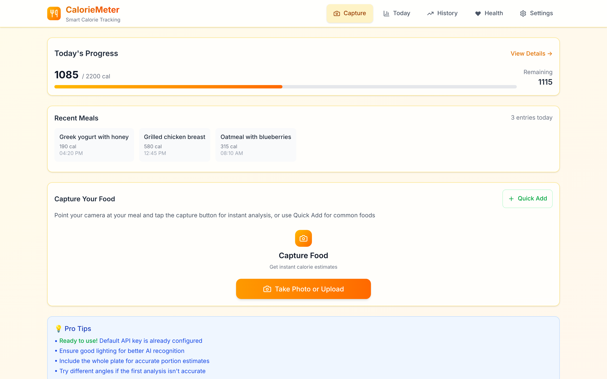
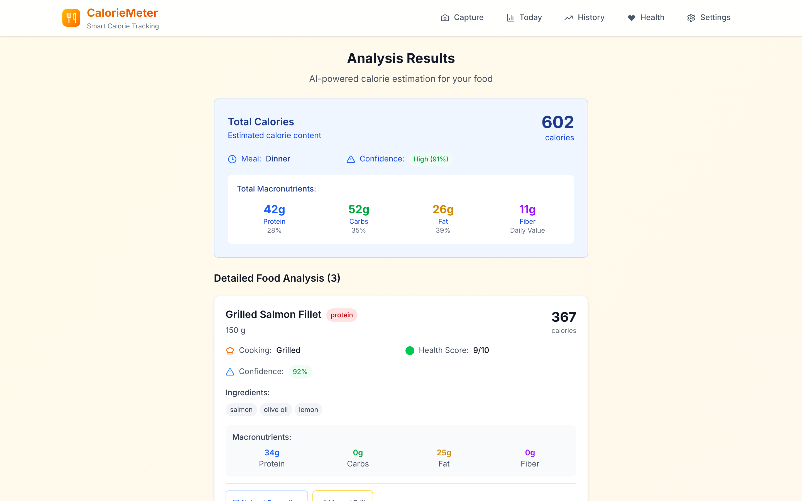
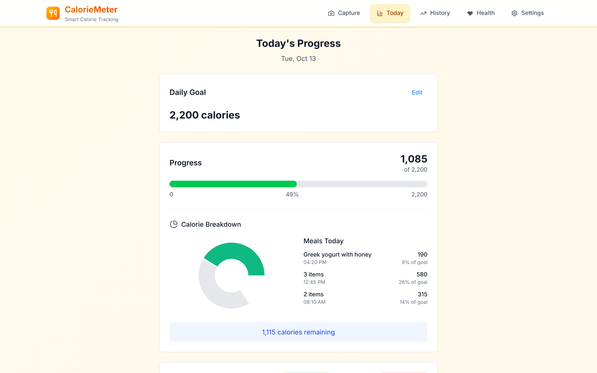
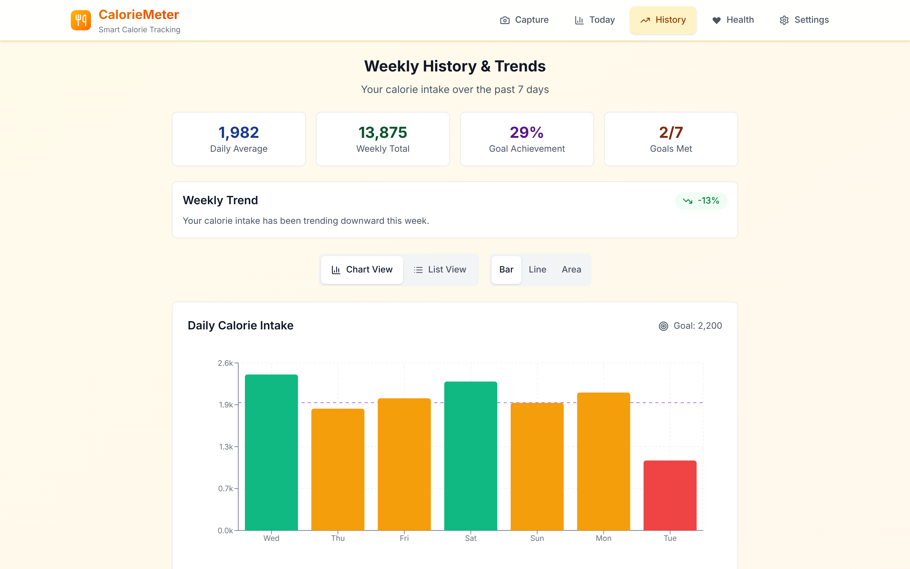
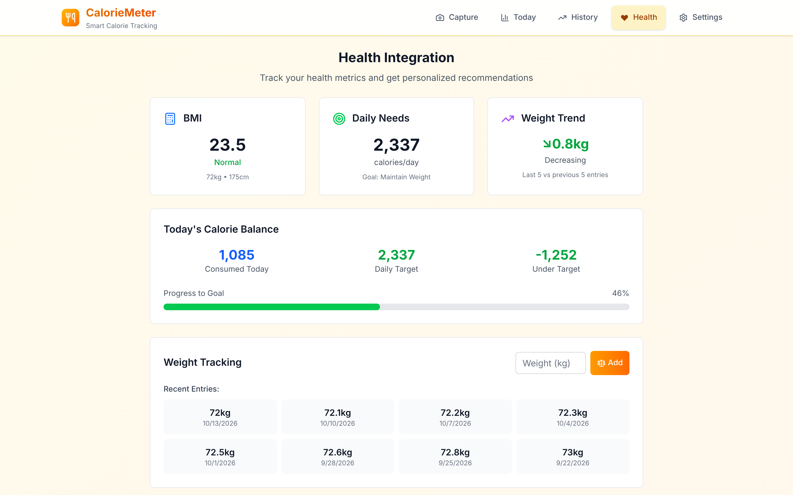
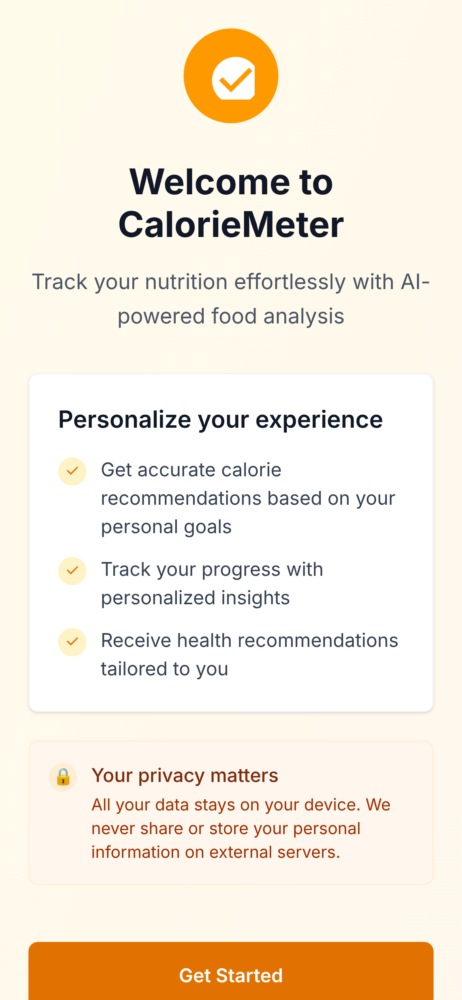
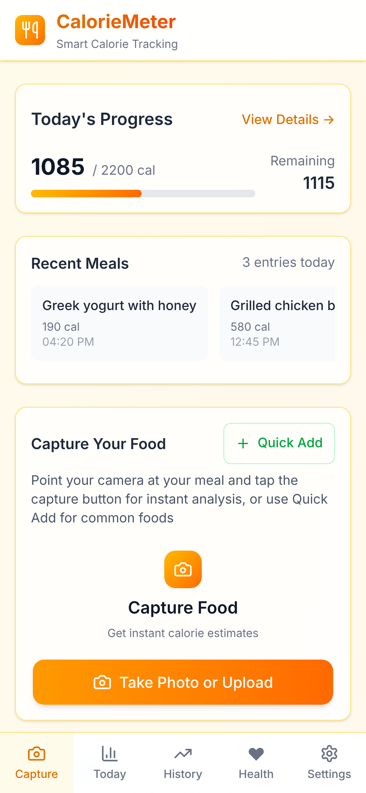
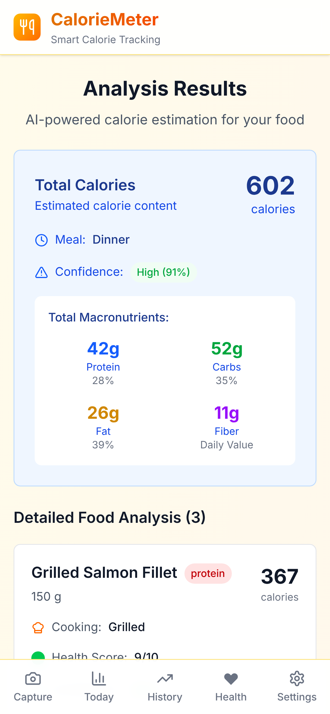
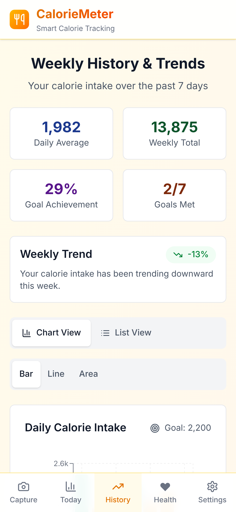
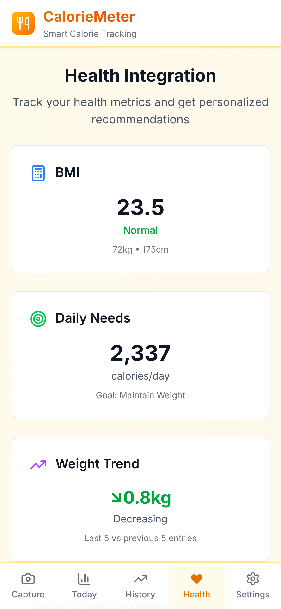

# CalorieMeter — portfolio case study

**AI-powered calorie tracking from a photo of your meal.**
Next.js 15 · React 19 · TypeScript · Google Gemini · TanStack Query · Tailwind CSS 4 · Recharts · PWA

---

## Problem

Calorie tracking works, but people quit because logging is tedious. Every meal means searching a food database, guessing portion sizes and entering each item by hand. Most people give up within a couple of weeks.

AI vision models can now recognise food in a photo, but on their own they aren't reliable enough for a tracker:

- **Estimates are often wrong**, especially for portion size and cooking method (fried vs. grilled can double the calories).
- **Free-tier APIs fail often.** They hit rate limits, time out, or a model goes offline, and a tracker that fails at lunchtime gets uninstalled.
- **Health data is personal.** Many people don't want their meals and body measurements stored on someone else's server.

The goal: make logging a meal take seconds, give users an easy way to fix the AI's mistakes, and keep their data on their own device.

## My part

Solo project. I designed, built and shipped the whole app.

- **Photo-to-nutrition pipeline.** Next.js API routes send each photo to Google Gemini and get back structured data for every food item: calories, portion, protein/carbs/fat/fiber, cooking method, ingredients and a confidence score.
- **Multi-model fallback.** If a model is rate-limited or unavailable, the request automatically moves to the next of five Gemini models (2.5 Flash → 2.5 Pro → 2.5 Flash-Lite → 3 Flash → 3 Pro). Each model has its own client-side rate limiting, and server errors are retried with backoff, so one model failing doesn't break the app.
- **Plain-language corrections.** Users can type "that's grilled, not fried" or "it was a large portion" instead of editing numbers. The AI re-estimates the meal, and the app saves each correction on the device as the basis for adjusting future estimates.
- **Personalised goals.** A 5-step onboarding flow calculates a daily calorie target from age, height, weight, activity level and goal (Harris-Benedict BMR × activity multiplier). It supports metric and imperial units.
- **Tracking and insights.** A daily progress view, a 7-day history with bar/line/area charts and trend detection, BMI and weight tracking, and a quick-add database of 70+ common foods for when you don't have a photo.
- **Private by design.** All personal data stays in the browser's local storage. Users can export, import or delete all of it.
- **Data layer and UX.** TanStack Query for caching and mutations, error boundaries, offline and slow-network detection, toast notifications, and a mobile-first layout with a bottom navigation bar. It installs as a Progressive Web App.
- **Testing.** Jest and React Testing Library tests for the calorie calculations, storage, the AI client and the main components.

## Outcome

- **A working end-to-end product:** photo in, itemised calories and macros out in a few seconds, logged to the daily total with one tap.
- **No more brittle single-model setup:** with five-model fallback and rate-limit handling, the app keeps working on free-tier API quotas.
- **Corrections take one sentence** instead of a manual edit form, which makes it practical to keep the log accurate.
- **No backend database or user accounts to run:** the app is just static hosting plus two serverless API routes, so it's cheap to host and there's no personal data to protect on a server.
- **One codebase works on desktop and phone,** and installs to the home screen as a PWA.

> Add real numbers here once you have them, e.g. "used by N people", "average logging time X seconds", or measured accuracy: "AI estimates within ±X% of labelled meals". Measured numbers make this section much stronger.

---

## Screenshots

### Desktop

| | |
|---|---|
|  |  |
| **Home:** today's progress, recent meals, capture | **AI analysis:** itemised calories, macros, confidence |
|  |  |
| **Today:** goal progress and meal breakdown | **History:** 7-day trends against the goal line |
|  | |
| **Health:** BMI, daily needs, weight trend | |

### Phone

| | | | | |
|---|---|---|---|---|
|  |  |  |  |  |
| Onboarding | Home | AI analysis | History | Health |

_Screenshots use sample data. The analysis screen shows a representative AI response._
